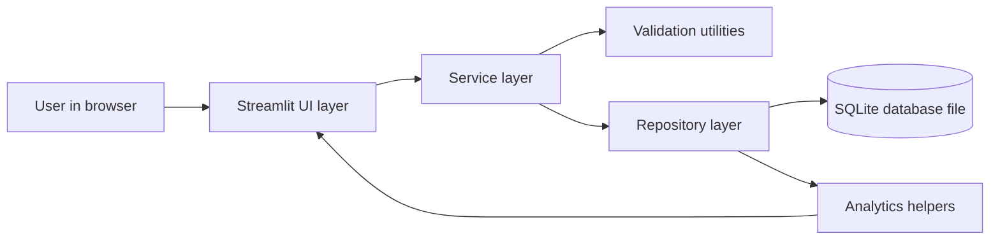
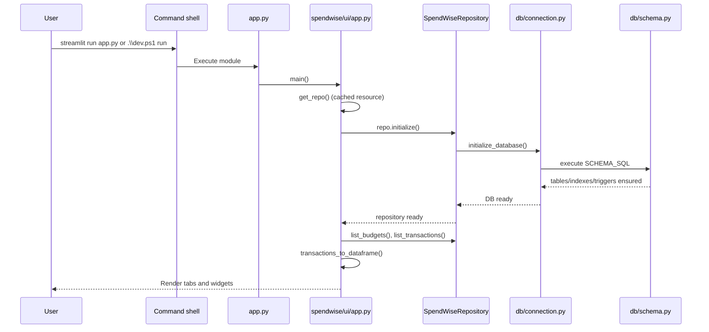
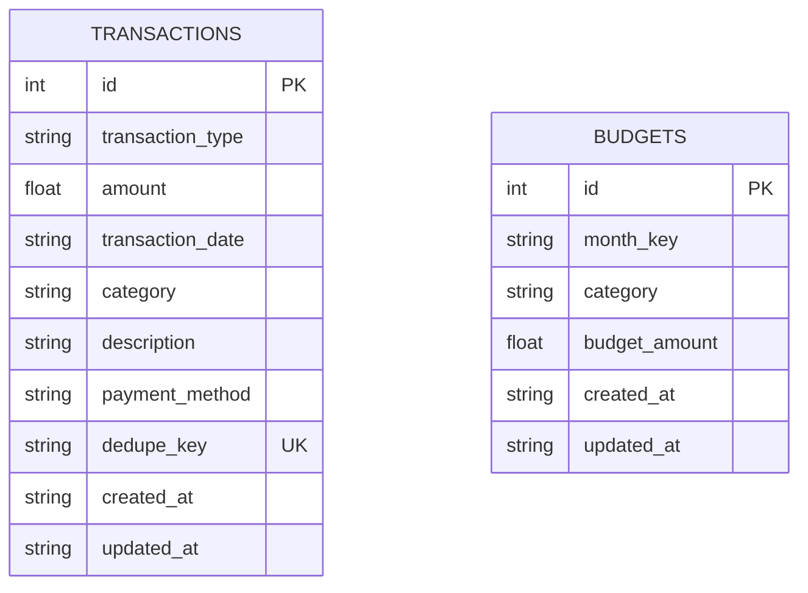
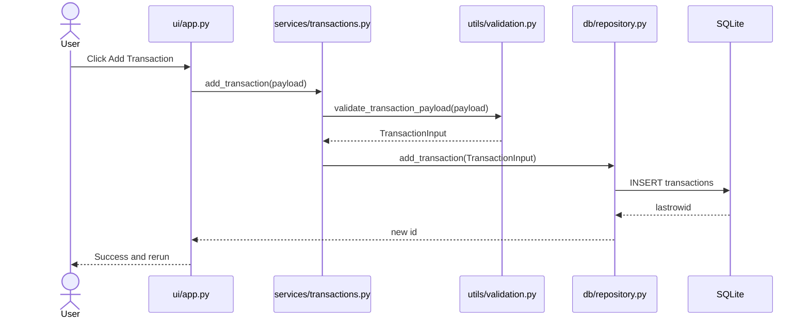
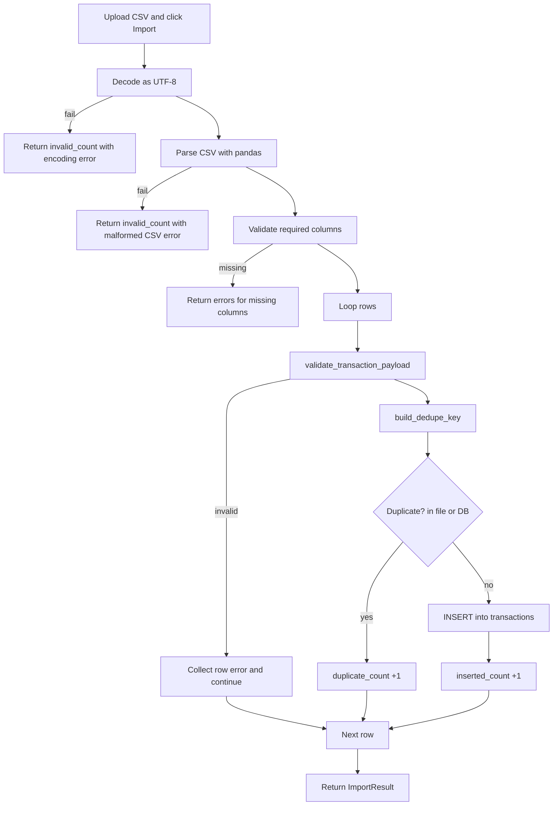

# SpendWise Technical Walkthrough (SDET-Friendly)

This document explains how SpendWise works end-to-end, including startup flow, module responsibilities, UI event handling, data validation, and database writes.

## 1. Project purpose and architecture style

SpendWise is a local-first Streamlit application.

- Frontend: Streamlit UI (Python code)
- Backend: Python service and repository layers inside the same process
- Storage: SQLite file on disk
- Analytics: Pandas + Plotly
- External API calls: None in normal app flow

You can think of this app as a layered monolith:

## 2. Where execution starts

### Entry points

- App launcher: [app.py](../app.py)
- UI orchestrator: [spendwise/ui/app.py](../spendwise/ui/app.py)
- Optional command helper: [dev.ps1](../dev.ps1)

### Startup sequence

When you run the app command, control flow is:

## 3. What each major file does

| File                                                                        | Responsibility                                          |
| --------------------------------------------------------------------------- | ------------------------------------------------------- |
| [app.py](../app.py)                                                         | Minimal entrypoint that calls UI main function          |
| [spendwise/ui/app.py](../spendwise/ui/app.py)                               | Streamlit screens, tabs, widgets, and click handlers    |
| [spendwise/services/transactions.py](../spendwise/services/transactions.py) | Transaction use-cases (add/edit/delete/list/delete-all) |
| [spendwise/services/budgets.py](../spendwise/services/budgets.py)           | Budget use-cases and budget status assembly             |
| [spendwise/services/csv_service.py](../spendwise/services/csv_service.py)   | CSV import/export, row-level validation, dedupe checks  |
| [spendwise/db/repository.py](../spendwise/db/repository.py)                 | All SQL calls, no UI logic                              |
| [spendwise/db/connection.py](../spendwise/db/connection.py)                 | DB connection lifecycle and initialization              |
| [spendwise/db/schema.py](../spendwise/db/schema.py)                         | SQL schema definition                                   |
| [spendwise/analytics/metrics.py](../spendwise/analytics/metrics.py)         | DataFrame transforms and monthly calculations           |
| [spendwise/utils/validation.py](../spendwise/utils/validation.py)           | Validation rules for transaction/budget payloads        |
| [spendwise/config.py](../spendwise/config.py)                               | App constants, default DB path, allowed values          |

## 4. Database model and behavior

DB file path comes from [spendwise/config.py](../spendwise/config.py), using BASE_DIR/spendwise.db.

Important schema behavior from [spendwise/db/schema.py](../spendwise/db/schema.py):

- transactions.transaction_type is constrained to income or expense
- amount and budget_amount are non-negative
- dedupe_key is unique (used for duplicate CSV protection)
- budgets has unique (month_key, category)
- update triggers auto-refresh updated_at timestamps

## 5. Request and data flow for common UI actions

There are no network API calls in these flows. Everything is an in-process Python function chain ending in SQLite operations.

### 5.1 Add transaction button

UI click path:

- [spendwise/ui/app.py](../spendwise/ui/app.py): render_transactions_tab -> \_render_transaction_form
- [spendwise/services/transactions.py](../spendwise/services/transactions.py): add_transaction
- [spendwise/utils/validation.py](../spendwise/utils/validation.py): validate_transaction_payload
- [spendwise/db/repository.py](../spendwise/db/repository.py): add_transaction
- SQLite: INSERT INTO transactions

### 5.2 Edit transaction button

- UI builds payload from selected row
- Service validates payload again
- Repository executes UPDATE transactions ... WHERE id = ?
- UI reruns and table refreshes

### 5.3 Delete transaction button

- UI calls remove_transaction with selected id
- Repository executes DELETE FROM transactions WHERE id = ?
- UI reruns and updates view

### 5.4 Delete all transactions button

- UI requires explicit checkbox confirmation
- UI calls remove_all_transactions
- Repository executes DELETE FROM transactions
- Budgets are intentionally not deleted

### 5.5 Set budget button

- UI sends month_key, category, budget_amount
- Service validates budget payload
- Repository runs UPSERT with ON CONFLICT(month_key, category)
- Existing category budget for that month is replaced

### 5.6 Delete budget button

- UI calls delete_budget with budget id
- Repository executes DELETE FROM budgets WHERE id = ?

### 5.7 Import CSV button

Path:

- [spendwise/ui/app.py](../spendwise/ui/app.py): Import CSV button handler
- [spendwise/services/csv_service.py](../spendwise/services/csv_service.py): import_transactions_from_csv_bytes
- decode UTF-8 -> parse CSV -> validate headers
- each row validated -> dedupe hash key generated -> duplicate checks in-memory + DB
- valid unique row inserted via repository
- final result includes inserted, duplicate, invalid counts + row errors

### 5.8 Export CSV button

- Service reads all transactions using repository list call
- Converts field names to export schema
- Returns CSV text to Streamlit download button

### 5.9 Load demo data button

- Reads [data/demo_transactions.csv](../data/demo_transactions.csv)
- Calls CSV import service for transaction rows
- Reads [data/demo_budgets.csv](../data/demo_budgets.csv)
- Upserts each budget row through budget service

## 6. Dashboard and analytics flow

Dashboard calculations are in [spendwise/analytics/metrics.py](../spendwise/analytics/metrics.py).

Main steps:

1. Fetch raw rows from repository
2. Convert to DataFrame and normalize types
3. Filter by selected month
4. Calculate summary metrics:
   - income = sum of income rows
   - expenses = sum of expense rows
   - balance = income - expenses
5. Aggregate category spending for pie chart
6. Build month-level trend for line chart
7. Build budget progress DataFrame from budget rows + category spending

## 7. Validation and error handling model

Validation is centralized in [spendwise/utils/validation.py](../spendwise/utils/validation.py).

- transaction_type must be income or expense
- amount must be numeric and non-negative
- date format must be YYYY-MM-DD
- payment_method must be one of configured methods
- budget month must be YYYY-MM
- text fields like category are required

Error reporting behavior:

- Form submit: ValueError message shown directly in UI
- CSV import: row-level error list with row number offset matching CSV line numbers
- Empty datasets: UI shows informational messages instead of crashing

## 8. Streamlit runtime model (important for debugging)

Streamlit reruns the script after most interactions.

In this project:

- After successful mutating actions, code calls st.rerun() for immediate refresh
- Repository object is cached as a resource via @st.cache_resource in get_repo()
- Data is re-queried each run, then charts/tables are redrawn

This is why a button click appears to "jump" back through main rendering code.

## 9. Test and CI coverage

Tests are in:

- [tests/test_metrics.py](../tests/test_metrics.py)
- [tests/test_budget_logic.py](../tests/test_budget_logic.py)
- [tests/test_csv_service.py](../tests/test_csv_service.py)
- [tests/test_transactions_service.py](../tests/test_transactions_service.py)

CI pipeline is in [.github/workflows/pytest.yml](../.github/workflows/pytest.yml):

- checkout code
- set Python 3.12
- install requirements-dev.txt
- run pytest -q

## 10. Practical tracing guide for SDET workflows

If you want to trace behavior quickly:

1. Put breakpoints in [spendwise/ui/app.py](../spendwise/ui/app.py) inside the button handlers.
2. Step into service calls in [spendwise/services/transactions.py](../spendwise/services/transactions.py), [spendwise/services/budgets.py](../spendwise/services/budgets.py), and [spendwise/services/csv_service.py](../spendwise/services/csv_service.py).
3. Step into SQL calls in [spendwise/db/repository.py](../spendwise/db/repository.py).
4. Verify table results directly from repository list methods or by inspecting spendwise.db.

Suggested manual test scenarios:

- Add valid transaction, verify dashboard numbers update
- Add invalid transaction (negative amount), verify validation error
- Import CSV with duplicate rows, verify duplicate_count increments
- Delete all transactions, verify budgets still exist
- Set budget and exceed spend, verify overspend warning is shown

## 11. Key takeaways

- This is a local app with clean UI -> service -> repository -> SQLite flow.
- No HTTP API layer is used in current design.
- Validation and business rules are mostly in service + utils modules.
- Analytics is deterministic and test-covered.
